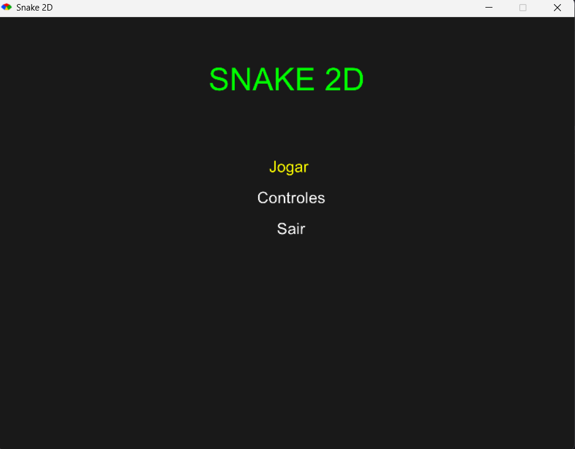
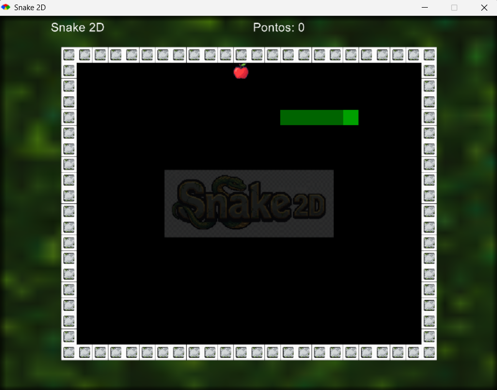
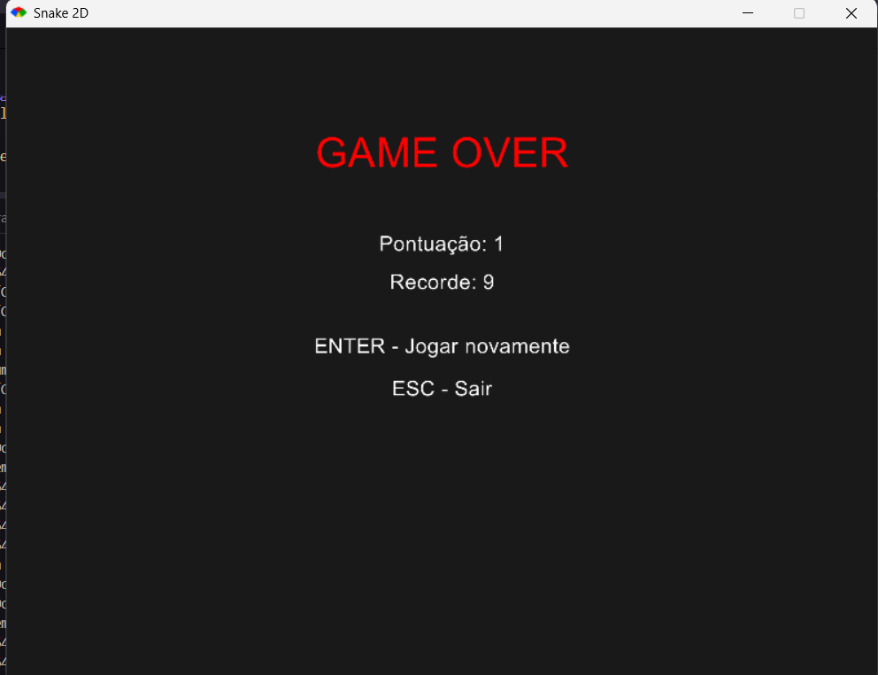

# Snake 2D

Snake 2D é um jogo da cobrinha desenvolvido em Ruby com a biblioteca Gosu. O projeto utiliza uma estrutura modular para separar a janela, os estados, as entidades, a interface, os gráficos e a persistência do recorde.

## Capturas de tela

<table>
  <tr>
    <th>Menu</th>
    <th>Jogo</th>
    <th>Game Over</th>
  </tr>
  <tr>
    <td></td>
    <td></td>
    <td></td>
  </tr>
</table>

## Funcionalidades

- Menu com opções de jogar, visualizar controles e sair.
- Movimento da cobra nas quatro direções.
- Comida gerada aleatoriamente, sem aparecer sobre a cobra.
- Crescimento da cobra ao coletar comida.
- Sistema de pontuação.
- Detecção de colisão com as bordas e com o próprio corpo.
- Tela de fim de partida.
- Registro do maior número de pontos em `save/highscore.txt`.

## Requisitos

- Ruby instalado.
- Biblioteca Gosu.

Instale a dependência:

```bash
gem install gosu
```

## Como executar

Na pasta raiz do projeto, execute:

```bash
ruby main.rb
```

## Controles

| Tecla                        | Ação                                             |
| ---------------------------- | ------------------------------------------------ |
| Setas direcionais            | Movimentar a cobra                               |
| Setas para cima e para baixo | Navegar pelo menu                                |
| Enter                        | Selecionar uma opção ou iniciar uma nova partida |
| Esc                          | Sair do jogo                                     |

## Como jogar

O objetivo é controlar a cobra, coletar as maçãs e aumentar a pontuação.

A cada maçã coletada, a cobra cresce e a pontuação aumenta. A partida termina quando a cobra colide com as bordas do tabuleiro ou com o próprio corpo.

O recorde é armazenado localmente em `save/highscore.txt`.

## Estrutura do projeto

```text
Snake 2D/
├── assets/
│   ├── fonts/
│   ├── images/
│   │   ├── backgrounds/
│   │   ├── food/
│   │   ├── tiles/
│   │   └── ui/
│   └── sounds/
├── entities/
│   ├── food.rb
│   └── snake.rb
├── graphics/
│   ├── assets.rb
│   └── sprites.rb
├── renderer/
│   └── snake_renderer.rb
├── save/
│   └── highscore.txt
├── services/
│   └── high_score.rb
├── states/
│   ├── game_over_state.rb
│   ├── menu_state.rb
│   └── play_state.rb
├── ui/
│   ├── button.rb
│   └── hud.rb
├── board.rb
├── config.rb
├── game.rb
└── main.rb
```

## Organização dos arquivos

- `main.rb`: ponto de entrada da aplicação.
- `game.rb`: inicializa a janela e controla a troca entre os estados.
- `config.rb`: reúne as configurações da janela, do tabuleiro e da velocidade.
- `board.rb`: desenha o cenário, a área de jogo e suas bordas.
- `entities/`: contém as entidades principais, como cobra e comida.
- `states/`: implementa os estados de menu, partida e fim de jogo.
- `graphics/`: carrega e mantém os recursos gráficos.
- `renderer/`: desenha a cobra na tela.
- `ui/`: contém elementos da interface, como o HUD.
- `services/high_score.rb`: carrega e salva o recorde.
- `assets/`: armazena imagens, fontes e sons.

## Tecnologias

- Ruby
- Gosu
